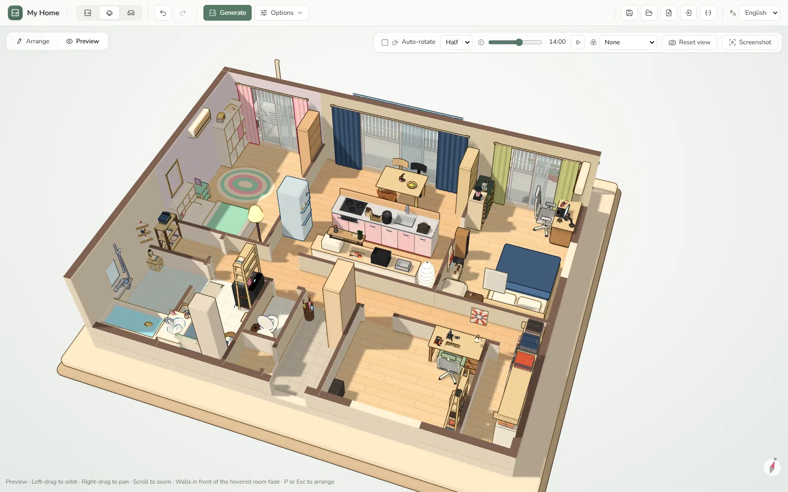

<p align="center">
  
  <h1 align="center">My Home</h1>
  <p align="center">
    <a href="https://home.jannchie.com">home.jannchie.com</a> · <a href="README.md">中文</a> · <a href="README.ja.md">日本語</a> · English
  </p>
  <p align="center">
    <a href="https://github.com/Jannchie/my-home/releases/latest"></a>
    <a href="LICENSE"></a>
  </p>
</p>

A floor plan editor and toon-shaded 3D diorama in the browser. Generate a layout, furnish it automatically from a household profile, and view it in 3D.



- Floor plans: Japanese (1K–3LDK), Chinese and Western generators; or draw rooms, doors, windows and fixtures by hand
- Auto-furnish based on household makeup, occupations, personalities and hobbies; a checklist fills in missing items
- 2600+ procedural assets, 9 style palettes, swappable fabric patterns
- 3D diorama: five wall display modes, sunlight by time, date and city, 12 post-processing looks, wandering pets and robots
- Touch input and offline PWA; UI in English, Chinese and Japanese

No server, no account. Data stays in the browser (localStorage, IndexedDB) and can be exported as JSON.

## Development

```sh
pnpm install
pnpm dev
pnpm test
pnpm build      # vue-tsc + vite build → dist/
pnpm gen:dims   # regenerate the asset dimension table
```

All assets are modeled in code under `src/three/packs/`; conventions are at the top of [`src/three/kit.ts`](src/three/kit.ts).

## License

[MIT](LICENSE)
