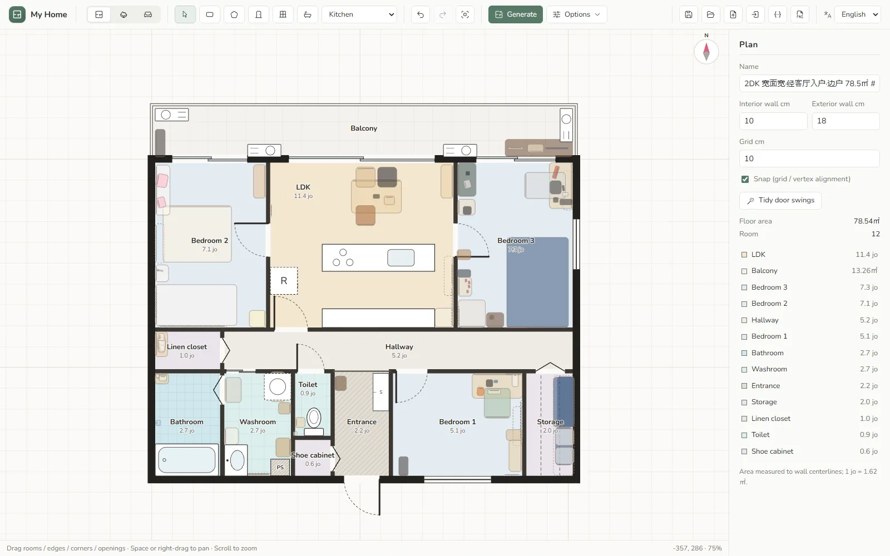
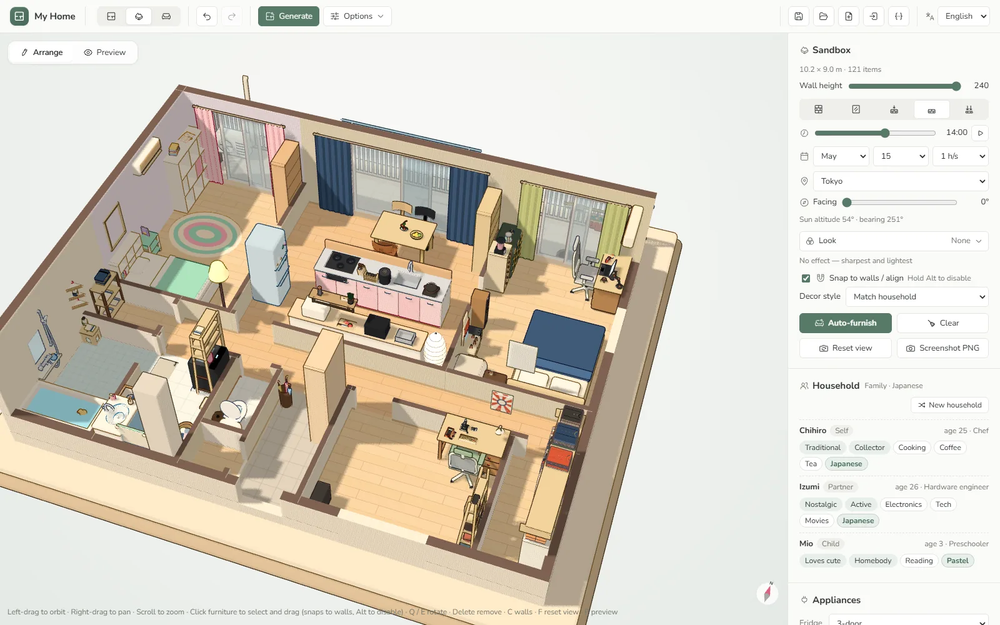
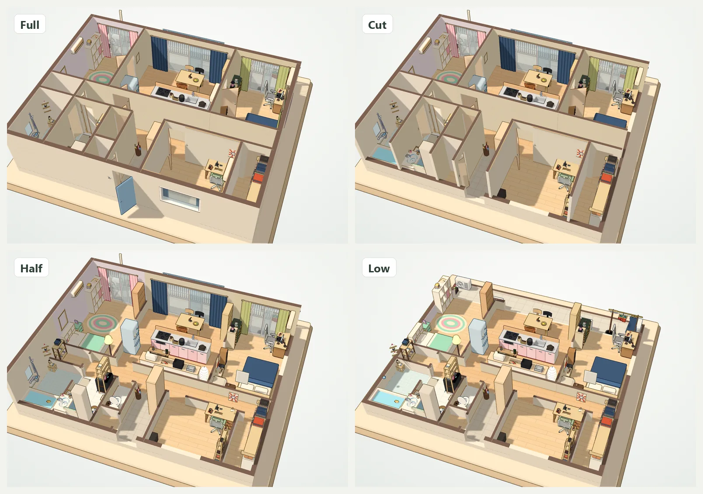
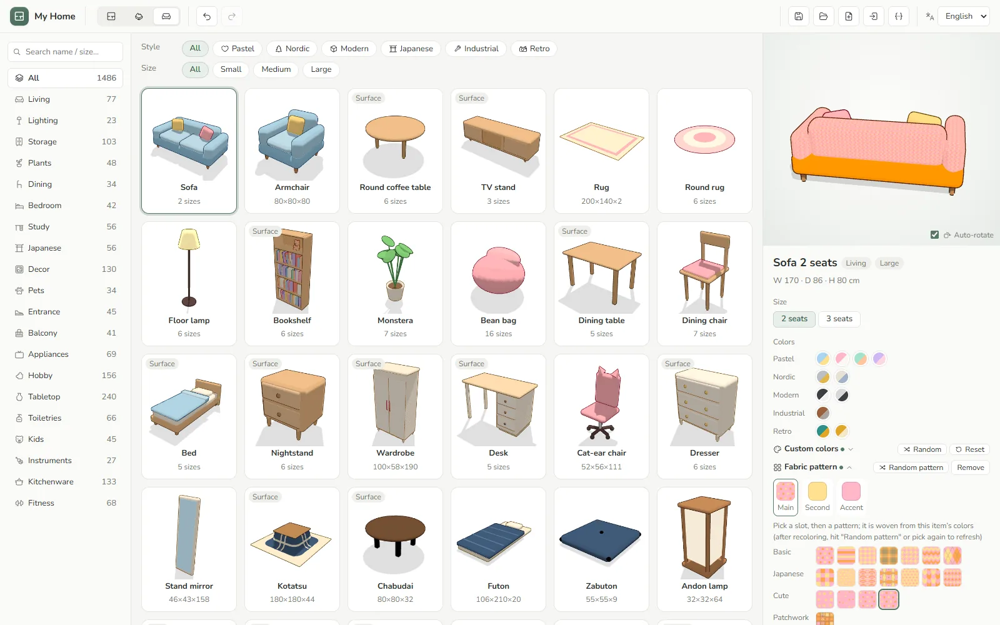
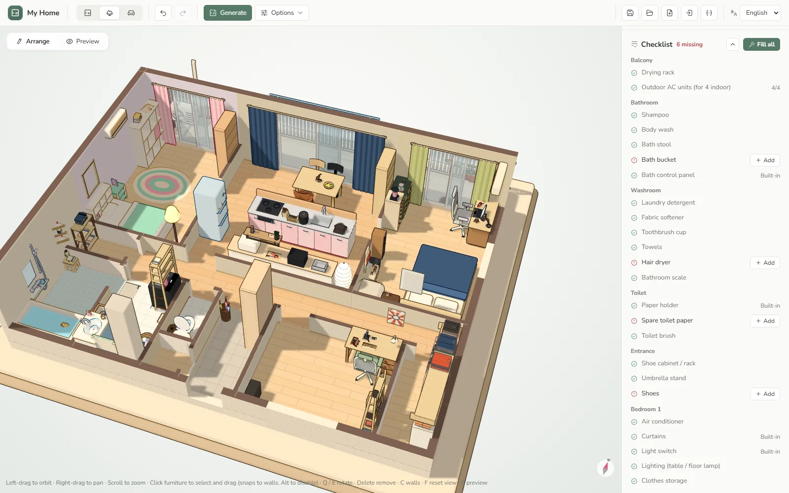
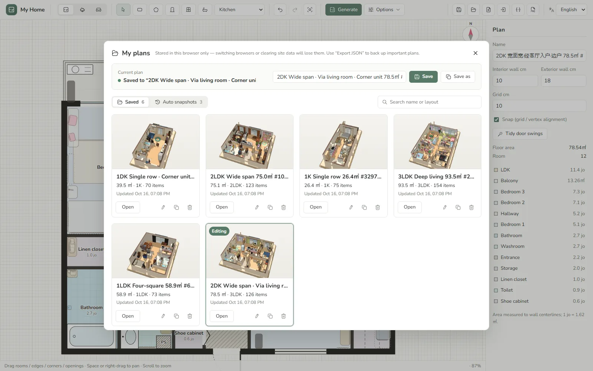

<div align="center">


# My Home

**Generate a Japanese home in your browser, then fill it with life.**

Roll a random 1K–3LDK apartment, furnish it in one click with 2,400+ toon-style assets picked for whoever lives there, and explore it as a 3D diorama.<br>
Runs entirely in the browser. Free, no sign-up, and your data never leaves your machine.

[](https://vuejs.org/)
[](https://threejs.org/)
[](https://www.typescriptlang.org/)
[](https://vite.dev/)
[](public/manifest.webmanifest)

[](LICENSE)

[**Try it online**](https://home.jannchie.com) · [中文](README.md) · [日本語](README.ja.md) · **English**

</div>

<br>

<p align="center">
  
</p>

## Features

<table>
  <tr>
    <td width="50%" valign="top">
      
      <h3>Floor plan generator and editor</h3>
      Generates 1K / 1DK / 1LDK / 2LDK / 3LDK layouts with everything a Japanese apartment has: a prefab unit bath, laundry space, genkan, a tatami room (mats laid out automatically), balcony, built-in shoe cabinet and walk-in closet. Pick the structure (four-square, deep living, wide span), corner unit, floor area or seed — or draw your own rooms with the rectangle and polygon tools, then add doors, windows and fixtures. Door swings are tidied up for you.
    </td>
    <td width="50%" valign="top">
      
      <h3>One-click furnishing, by household</h3>
      First it imagines who lives there — household, ages, jobs, personalities, hobbies — then furnishes to match, down to the small stuff: clothes on the rack, fridge magnets, socks on the drying hanger, a bathroom scale. Spare rooms become a study, a gaming den or a music room. Item counts are capped per type and common items rotate between designs, so no two homes look alike.
    </td>
  </tr>
  <tr>
    <td width="50%" valign="top">
      
      <h3>Sims-style walls</h3>
      Five wall modes — Full, Fade, Cut, Half and Low — cycled with <kbd>C</kbd>. Walls can also step aside only for the room under your cursor. Toon shading with outlines, and the scene only re-renders when something changes, so it stays easy on laptops.
    </td>
    <td width="50%" valign="top">
      
      <h3>Asset library, colors and patterns</h3>
      2,400+ procedurally modeled assets across six styles: Pastel, Nordic, Modern, Japanese, Industrial and Shōwa Retro. Recolor anything and weave patterns into fabrics — polka dots, plaid, traditional Japanese motifs, patchwork. Some assets also switch forms: hung, stacked or opened.
    </td>
  </tr>
  <tr>
    <td width="50%" valign="top">
      
      <h3>Checklist</h3>
      A room-by-room list of what a lived-in home needs: a bath bucket in the bathroom, a spare toilet roll, shoes in the genkan. Add missing items one at a time, or fill every gap in one click.
    </td>
    <td width="50%" valign="top">
      
      <h3>My plans</h3>
      Plans are saved in your browser (IndexedDB) with 3D thumbnails. Search, rename and duplicate them; automatic snapshots while you edit let you roll back mistakes. Export and import JSON, or export the floor plan and 3D view as PNG.
    </td>
  </tr>
</table>

### A home that moves

<p align="center">
  
</p>

Switch to preview mode and the pets start living there: cats and dogs wander and nap, the robot vacuum heads out to clean and returns to its dock, and Kachaka carries its shelf from room to room. They path-find around furniture and walls.

### Also

- **Wallpaper and trim**: per-room wallpaper (solid or patterned) with chair-rail trim, or randomize the whole home to match the household's style.
- **Clothes and hangers**: parametric garments and towels on closet rods and drying racks, with hangers modeled separately.
- **Three languages**: Simplified Chinese, Japanese and English, picked from your browser language or set with `/ja/`, `/en/` or `?lang=ja`.
- **PWA and SEO**: installable to the desktop; four entry pages, each with its own localized title, Open Graph tags and JSON-LD.

### In progress

- Chinese and Western floor plan generators
- Continuous daylight, with the sun position computed from time, date, latitude/longitude and building orientation
- Post-processing looks: tilt-shift, film, watercolor, screentone, pixel art…

## Getting started

Requires Node.js 20+ and [pnpm](https://pnpm.io/).

```bash
pnpm install
pnpm dev      # dev server
pnpm test     # unit tests (Vitest)
pnpm build    # type-check and build the static site into dist/
```

## Deployment

`dist/` is plain static files, so any static host will do. Absolute URLs in canonical, `og:url`, hreflang, `sitemap.xml` and `robots.txt` default to `https://home.jannchie.com`. To deploy under your own domain, override them with the `VITE_SITE_URL` environment variable by creating `.env.production` in the project root:

```bash
VITE_SITE_URL=https://your-domain.example
```

Or pass it at build time: `VITE_SITE_URL=https://your-domain.example pnpm build`. The build emits four entry pages: `/` (switches language at runtime) plus `/zh/`, `/ja/` and `/en/`. The SEO copy for all three languages lives in `src/seo.ts`.

## Project structure

```text
src/
├─ App.vue, components/   UI: floor plan canvas, 3D diorama, asset library, color editor, my plans
├─ generate*.ts           Floor plan generation (Japanese; Chinese / Western dispatched by region)
├─ household.ts           Household profiles: members, jobs, personalities, hobbies
├─ decorate.ts            One-click furnishing
├─ checklist.ts           Checklist
├─ store.ts, saved.ts     Editor state and undo; IndexedDB saves and auto-snapshots
├─ walls.ts, doors.ts, tatami.ts, place.ts, snap.ts, nav.ts
│                         Wall analysis, door swings, tatami layout, fixture placement, snapping, pet path-finding
├─ i18n/                  Chinese / Japanese / English strings
└─ three/                 3D: toon rendering, house builder, assets and asset packs, patterns, garments, pets and robots, sky, post-processing
test/                     Vitest unit tests
scripts/                  Asset dimension table generator (pnpm gen:dims)
```

## Making assets

Every asset is modeled in code; there are no external model files. Before writing a new one, read the conventions at the top of [`src/three/kit.ts`](src/three/kit.ts): units are centimeters, the wall-facing side points to −z, outlines are added centrally, surface decals float at least 0.3 cm off the surface, and furniture that holds other items declares a `surface` instead of baking those items into the model. Asset packs live in `src/three/packs/`.

## Data and privacy

There is no server and no account. The current plan and UI settings live in `localStorage`; saved plans and auto-snapshots live in IndexedDB — all inside your own browser. Clearing site data removes them too, so back up plans you care about with "Export JSON".

## Acknowledgements

- [three.js](https://threejs.org/) for 3D rendering
- [Vue](https://vuejs.org/) and [Vite](https://vite.dev/)
- [jannchie-icons](https://www.npmjs.com/package/@jannchie/icons) (`@jannchie/icons`, `@jannchie/icons-vue`) for UI icons

## Author

[Jianqi Pan (Jannchie)](https://github.com/Jannchie)

## License

[MIT](LICENSE) © 2026 Jianqi Pan
