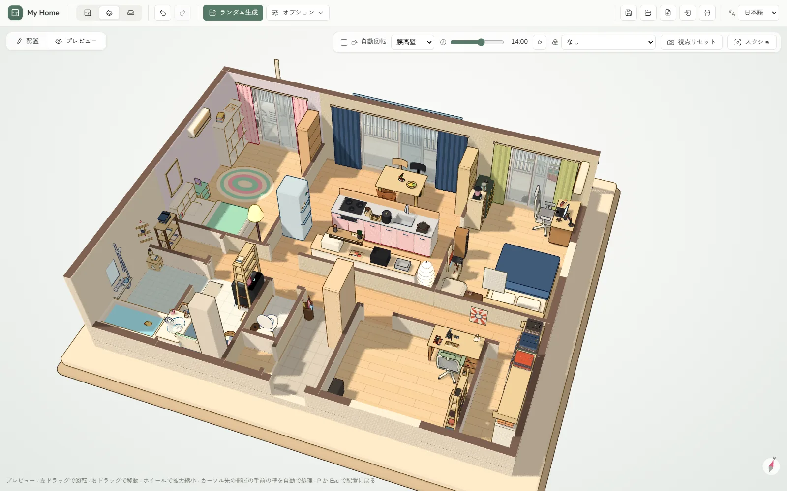
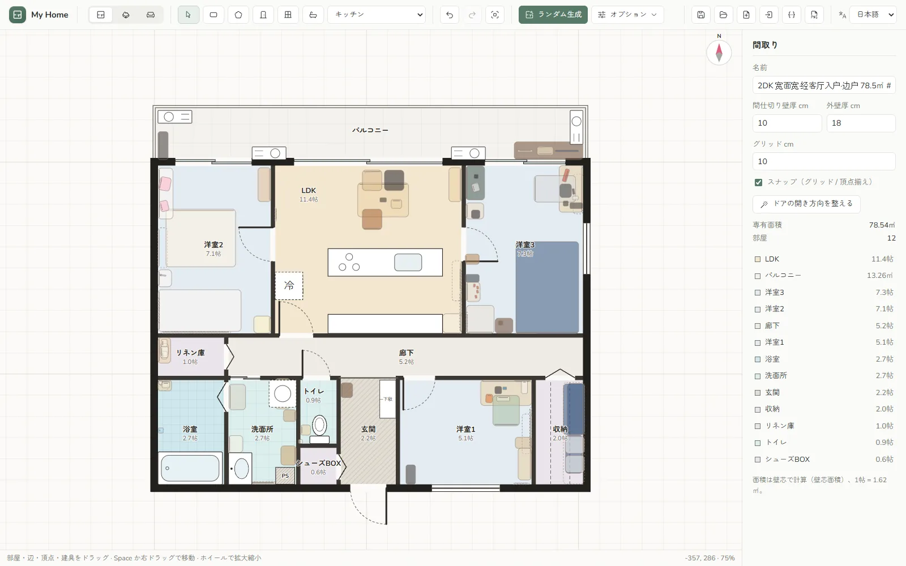
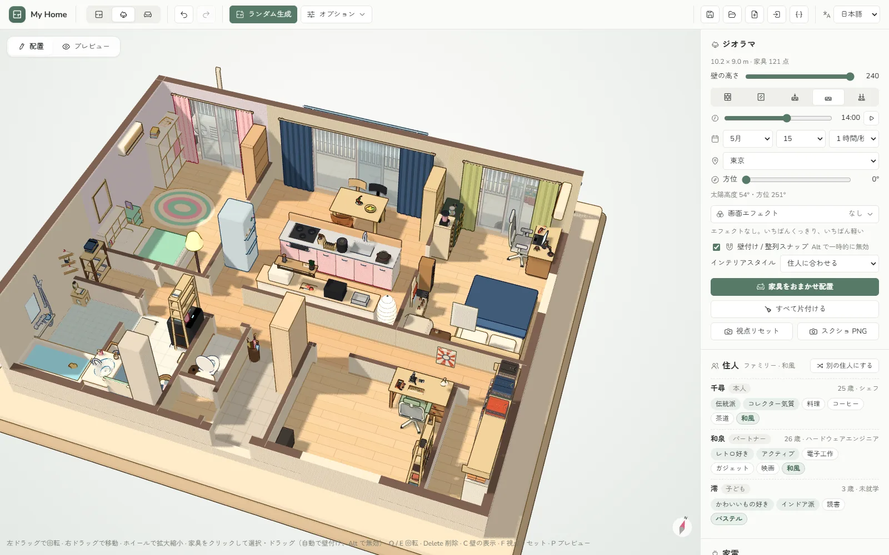
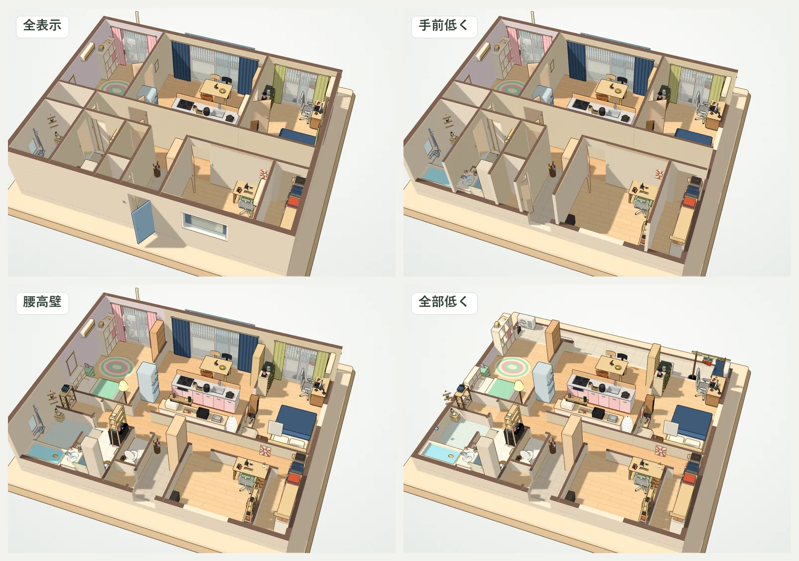
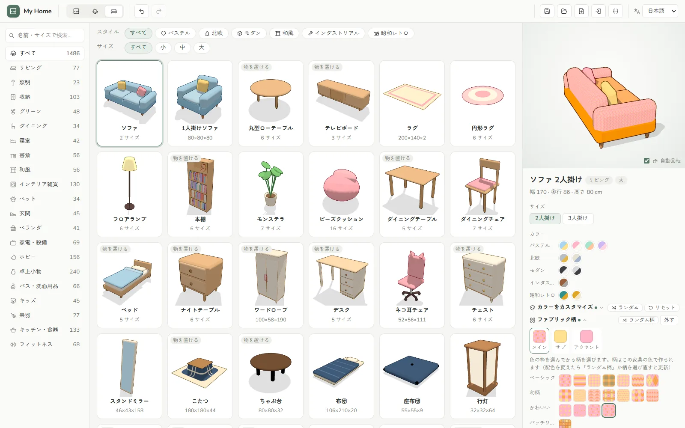
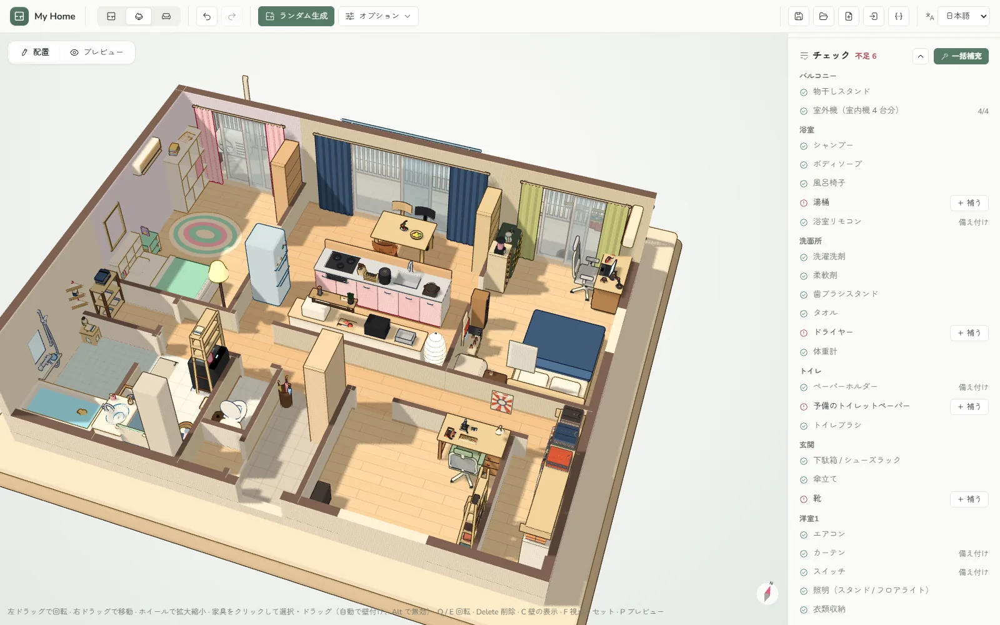
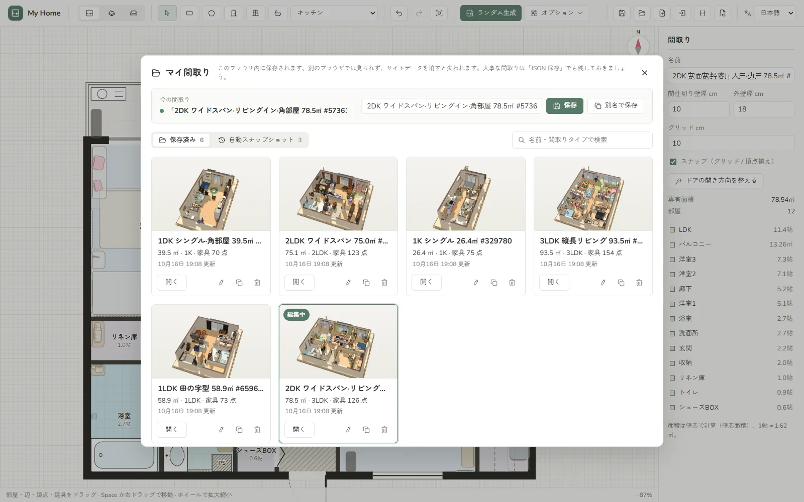
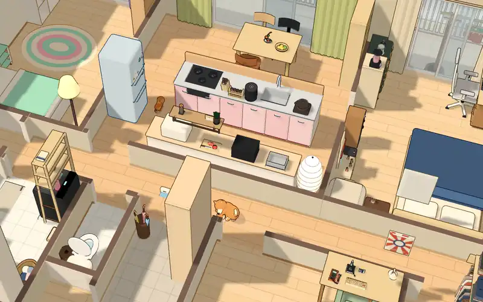

<div align="center">


# My Home

**ブラウザで日本の間取りをつくって、暮らしまで並べよう。**

1K〜3LDK の間取りをランダムに生成し、住む人に合わせて 2400 点以上のトゥーン調素材をおまかせ配置。3D ジオラマでじっくり眺められます。<br>
ブラウザだけで動き、無料・登録不要。データはあなたのブラウザの中にだけ保存されます。

[](https://vuejs.org/)
[](https://threejs.org/)
[](https://www.typescriptlang.org/)
[](https://vite.dev/)
[](public/manifest.webmanifest)

[](LICENSE)

[**デモを試す**](https://home.jannchie.com) · [中文](README.md) · **日本語** · [English](README.en.md)

</div>

<br>

<p align="center">
  
</p>

## できること

<table>
  <tr>
    <td width="50%" valign="top">
      
      <h3>間取りの自動生成と編集</h3>
      1K / 1DK / 1LDK / 2LDK / 3LDK をランダムに生成。ユニットバス、洗濯機置場、玄関、和室（畳割りも自動）、バルコニー、シューズBOX、WIC まで再現します。田の字型・縦長リビング・ワイドスパンなどの骨格、角部屋、面積、シードも指定可能。矩形・多角形ツールで自分で描いて、建具や設備を置くこともできます。ドアの開き方向は自動で整えます。
    </td>
    <td width="50%" valign="top">
      
      <h3>住む人を想定したおまかせ配置</h3>
      まず間取りから住人を想定します。家族構成、年齢、職業、性格、趣味。それに合わせて家具と生活小物を並べます。ハンガーラックの服、冷蔵庫のマグネット、物干しの靴下、体重計……。空き部屋は書斎やゲーム部屋、音楽室に。同じ種類のものは数に上限があり、定番アイテムはデザインを入れ替えるので、毎回ちがう部屋になります。
    </td>
  </tr>
  <tr>
    <td width="50%" valign="top">
      
      <h3>シムズ風の壁表示</h3>
      全表示・手前透過・手前低く・腰高壁・全部低く の 5 モードを <kbd>C</kbd> で切り替え。マウスで指した部屋の手前だけ壁をよけることもできます。輪郭線つきのトゥーン描画で、画面が止まっているあいだは再描画しないのでノート PC にもやさしい設計です。
    </td>
    <td width="50%" valign="top">
      
      <h3>素材ライブラリ・配色・柄</h3>
      すべてコードで生成した 2400 点以上の素材。パステル、北欧、モダン、和風、インダストリアル、昭和レトロの 6 テイスト。どの素材も配色を変えられ、ファブリックには柄（水玉、チェック、和柄、パッチワーク…）を織り込めます。吊るす・積む・開くなど、形を切り替えられる素材もあります。
    </td>
  </tr>
  <tr>
    <td width="50%" valign="top">
      
      <h3>チェックリスト</h3>
      暮らしに必要なものを部屋ごとに確認。浴室に湯桶はあるか、トイレに予備のトイレットペーパーはあるか、玄関に靴はあるか。足りないものは 1 つずつ「足す」ことも、まとめて補うこともできます。
    </td>
    <td width="50%" valign="top">
      
      <h3>マイ間取り</h3>
      間取りはブラウザ内（IndexedDB）に 3D サムネイルつきで保存。検索・名前の変更・複製ができ、編集中は自動スナップショットを撮るので、うっかり崩しても戻せます。JSON の書き出し・読み込み、間取り図や 3D スクリーンショットの PNG 書き出しにも対応。
    </td>
  </tr>
</table>

### 動きのある家

<p align="center">
  
</p>

プレビューモードにすると、猫や犬が家の中を散歩したり昼寝したり。ロボット掃除機は掃除に出かけて充電台に戻り、Kachaka は棚を載せて部屋から部屋へものを運びます。家具や壁をよけて道を探して歩きます。

### そのほか

- **壁紙と見切り**：部屋ごとに壁紙（無地・柄）と腰見切りを変更。住人のテイストに合わせて全室ランダムにも。
- **服とハンガー**：パラメトリックに生成した服やタオルを、ハンガーパイプや物干しに。ハンガーと服は別々にモデリング。
- **3 か国語対応**：简体中文 / 日本語 / English。ブラウザの言語で自動選択し、`/ja/`・`/en/` のパスや `?lang=ja` でも指定できます。
- **PWA と SEO**：デスクトップにインストール可能。4 つの入口ページに、それぞれの言語の title・Open Graph・JSON-LD を用意しています。

### 開発中

- 中国式・欧米式の間取り生成
- 時刻・日付・緯度経度・建物の向きから太陽の位置を計算する、連続的な日照表現
- ポストエフェクト：ミニチュア風、フィルム、水彩、スクリーントーン、ピクセル……

## はじめかた

Node.js 20 以上と [pnpm](https://pnpm.io/) が必要です。

```bash
pnpm install
pnpm dev      # 開発サーバー
pnpm test     # ユニットテスト（Vitest）
pnpm build    # 型チェック + dist/ に静的サイトをビルド
```

## デプロイ

`dist/` は静的ファイルだけなので、どの静的ホスティングにも置けます。canonical、`og:url`、hreflang、`sitemap.xml`、`robots.txt` の絶対 URL は既定で `https://home.jannchie.com` です。自分のドメインに置く場合は環境変数 `VITE_SITE_URL` で上書きします。プロジェクト直下に `.env.production` を作成してください。

```bash
VITE_SITE_URL=https://your-domain.example
```

ビルド時に渡しても構いません：`VITE_SITE_URL=https://your-domain.example pnpm build`。ビルドすると `/`（実行時にブラウザの言語で切り替え）と `/zh/`・`/ja/`・`/en/` の 4 つの入口ページが出力されます。3 か国語の SEO 文言は `src/seo.ts` にあります。

## ディレクトリ構成

```text
src/
├─ App.vue, components/   UI：間取りキャンバス、3D ジオラマ、素材ライブラリ、配色エディタ、マイ間取り
├─ generate*.ts           間取り生成（日本式。中国式・欧米式は地域ごとに振り分け）
├─ household.ts           住人の想定：家族構成、職業、性格、趣味
├─ decorate.ts            おまかせ配置
├─ checklist.ts           チェックリスト
├─ store.ts, saved.ts     編集状態と Undo、IndexedDB への保存と自動スナップショット
├─ walls.ts, doors.ts, tatami.ts, place.ts, snap.ts, nav.ts
│                         壁の解析、ドアの開き方向、畳割り、設備配置、スナップ、ペットの経路探索
├─ i18n/                  中・日・英の文言
└─ three/                 3D：トゥーン描画、間取りのモデル化、素材と素材パック、柄、服、ペットとロボット、空、ポストエフェクト
test/                     Vitest のユニットテスト
scripts/                  素材寸法表の生成（pnpm gen:dims）
```

## 素材のつくりかた

素材はすべてコードでモデリングしていて、外部のモデルファイルはありません。新しい素材を書く前に [`src/three/kit.ts`](src/three/kit.ts) 冒頭の約束ごとを読んでください。単位は cm、壁側は −z 向き、輪郭線は共通処理で付ける、表面に貼るパーツは 0.3cm 以上浮かせる、ものを載せられる家具はモデルに作り込まず `surface` を宣言する……など。素材パックは `src/three/packs/` にあります。

## データとプライバシー

サーバーもアカウントもありません。今の間取りと画面設定は `localStorage`、「マイ間取り」の保存データと自動スナップショットは IndexedDB に入り、どちらもあなたのブラウザの中だけにあります。サイトデータを消すと一緒に消えるので、大事な間取りは「JSON 保存」でバックアップしてください。

## 謝辞

- [three.js](https://threejs.org/)：3D 描画
- [Vue](https://vuejs.org/) と [Vite](https://vite.dev/)
- [jannchie-icons](https://www.npmjs.com/package/@jannchie/icons)（`@jannchie/icons`、`@jannchie/icons-vue`）：UI アイコン

## 作者

[Jianqi Pan (Jannchie)](https://github.com/Jannchie)

## ライセンス

[MIT](LICENSE) © 2026 Jianqi Pan
