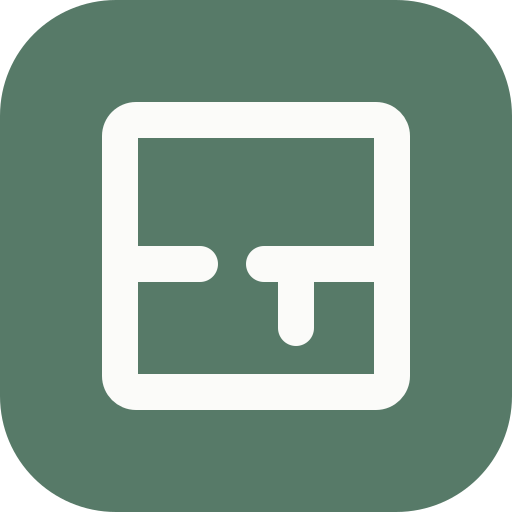
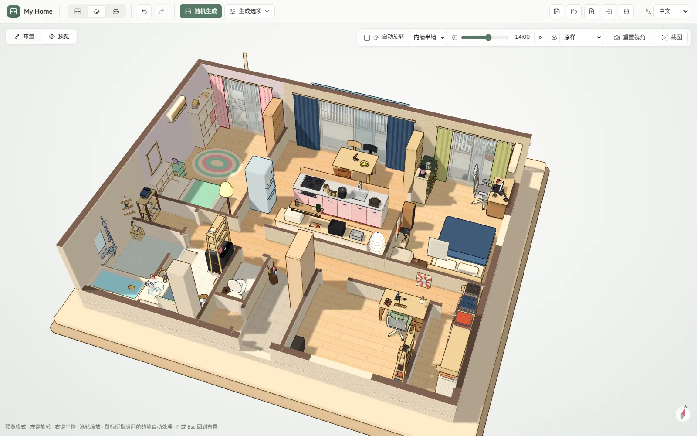

<p align="center">
  
  <h1 align="center">My Home</h1>
  <p align="center">
    <a href="https://home.jannchie.com/zh/"><b>在线体验</b></a>
  </p>
  <p align="center">
    中文 · <a href="README.ja.md">日本語</a> · <a href="README.en.md">English</a>
  </p>
  <p align="center">
    <a href="https://github.com/Jannchie/my-home/releases/latest"></a>
    <a href="LICENSE"></a>
  </p>
</p>

浏览器里的户型编辑器与 3D 卡通沙盘。生成户型，按住户设定自动布置家具，在 3D 中查看。



- 户型生成：日式（1K–3LDK）、中式（几室几厅）、欧美；也可在平面图中手绘，放置门窗与设备
- 一键布置：按家庭构成、职业、性格、兴趣摆放家具与小物，检查清单补齐缺项
- 2900+ 程序化素材，9 种风格配色，布艺花纹可换
- 3D 沙盘：五种墙体显示模式；按时刻、日期、城市计算日照；15 种画面效果；宠物与机器人会走动
- 支持触屏与 PWA 离线使用；界面为中、日、英三语

无服务器、无账号。数据保存在浏览器本地（localStorage、IndexedDB），可导出 JSON。

## 开发

```sh
pnpm install
pnpm dev
pnpm test
pnpm build      # vue-tsc + vite build → dist/
pnpm gen:dims   # 重新生成素材尺寸表
```

素材全部以代码建模，位于 `src/three/packs/`，约定见 [`src/three/kit.ts`](src/three/kit.ts) 文件头。

## License

[MIT](LICENSE)
