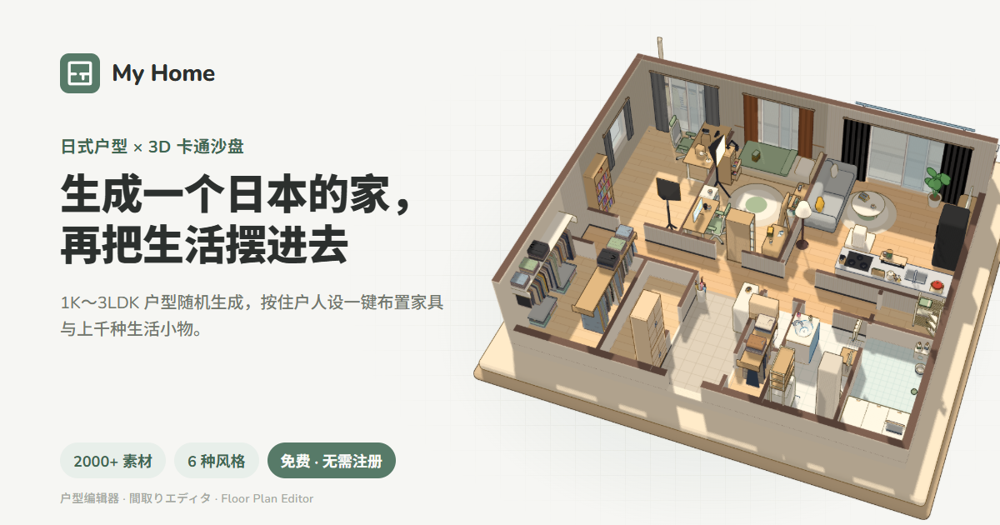

# My Home

**在浏览器里生成一个日本的家，再把生活摆进去。**

日式户型编辑器 + 3D 卡通沙盘：随机生成 1K～3LDK 户型，按住户人设一键布置家具和上千种生活小物，然后在 3D 里看看这个家。纯前端，免费，无需注册。



[中文](#功能) · [日本語](#日本語) · [English](#english)

## 功能

- **户型生成**：随机生成 1K / 1DK / 1LDK / 2LDK / 3LDK 日本住宅户型，ユニットバス、洗濯機置場、玄関、和室、阳台、WIC 一应俱全；可指定骨架（田の字、縦長リビング、ワイドスパン）、角部屋、面积范围和种子。也可以用矩形 / 多边形工具自己画，再放门窗和设备。
- **一键布置**：先推断住户（家庭构成、职业、性格、兴趣），再按人设摆家具和生活小物：杆上挂的衣服、冰箱贴、晾衣架上的袜子、体重秤……空房间会按兴趣变成书房、电竞房、音乐室等。
- **3D 卡通沙盘**：toon 描边的 anime 风渲染；模拟人生式墙体显示（完整 / 前墙透明 / 前墙压低 / 内墙半墙 / 全部压低）；会走动的猫狗、扫地机器人和 Kachaka。
- **素材库**：2000+ 素材，6 种风格（可爱、北欧、现代、和风、工业、复古），可自定义配色与布艺花纹，墙纸与边饰；检查清单一键补齐缺的东西。
- **导出**：平面图 PNG、3D 截图 PNG、户型 JSON（可再导入）。
- **三语界面**：简体中文 / 日本語 / English，按浏览器语言自动选择；也可以用 `/ja/`、`/en/` 路径或 `?lang=ja` 指定。

## 本地运行

需要 Node.js 20+ 和 pnpm。

```bash
pnpm install && pnpm dev
```

构建静态站点（产物在 `dist/`，可以部署到任意静态托管）：

```bash
pnpm build
```

## 部署前：设置站点地址

canonical、`og:url`、`og:image`、hreflang、`sitemap.xml`、`robots.txt` 里的绝对地址都来自环境变量 `VITE_SITE_URL`，没设置时是占位的 `https://my-home.example`。上线前在项目根目录新建 `.env.production`：

```bash
VITE_SITE_URL=https://你的域名
```

或者在构建时传入：`VITE_SITE_URL=https://你的域名 pnpm build`。

构建会输出四个入口页：`/`（默认，运行时按浏览器语言切换）和 `/zh/`、`/ja/`、`/en/`（各自写死了对应语言的 title、description、Open Graph、Twitter Card 和 JSON-LD，方便搜索引擎和社交平台抓取）。三语文案在 `src/seo.ts`，生成逻辑在 `vite.config.ts` 的 `seo` 插件里。

## 数据存储

所有数据只保存在你自己浏览器的 `localStorage` 里（户型、界面语言等），不会上传到任何服务器。清除浏览器数据会清掉存档，重要的户型请用「导出 JSON」备份。

## 技术栈

- [Vue 3](https://vuejs.org/) + TypeScript + [Vite](https://vite.dev/)
- [three.js](https://threejs.org/)：3D 沙盘与 toon 渲染
- [@jannchie/icons](https://www.npmjs.com/package/@jannchie/icons)：界面图标
- 字体：Nunito / Noto Sans SC / Zen Maru Gothic（Google Fonts，按语言加载）

## 日本語

**ブラウザで日本の間取りをつくって、暮らしまで並べよう。**

My Home は、ブラウザで動く日本の間取りエディタです。1K〜3LDK の間取りをランダムに生成し（ユニットバス、洗濯機置場、玄関、和室、バルコニーまで再現）、自分で描くこともできます。おまかせ配置では、まず住む人の家族構成・職業・性格・趣味を想定し、それに合わせて家具と細かな生活小物まで並べます。空き部屋は書斎やゲーム部屋、音楽室に。3D のトゥーン調ジオラマでは、猫や犬、ロボット掃除機が歩き回ります。素材 2000 点以上・6 つのテイスト、無料・登録不要で、データはブラウザの中にだけ保存されます。

## English

**Generate a Japanese home in your browser, then fill it with life.**

My Home is a Japanese floor plan editor that runs in your browser. It generates 1K–3LDK apartments (unit bath, laundry space, genkan, tatami room and balcony included) or lets you draw your own. One-click furnishing first imagines who lives there (household, job, personality, hobbies), then places furniture and over a thousand everyday items to match, turning spare rooms into a study, gaming room or music room. Explore it as a toon-shaded 3D diorama with wandering cats, dogs and robot vacuums. 2,000+ assets, 6 styles, free, no sign-up, and your data stays in your browser.

## 作者

[Jianqi Pan (Jannchie)](https://github.com/Jannchie)
