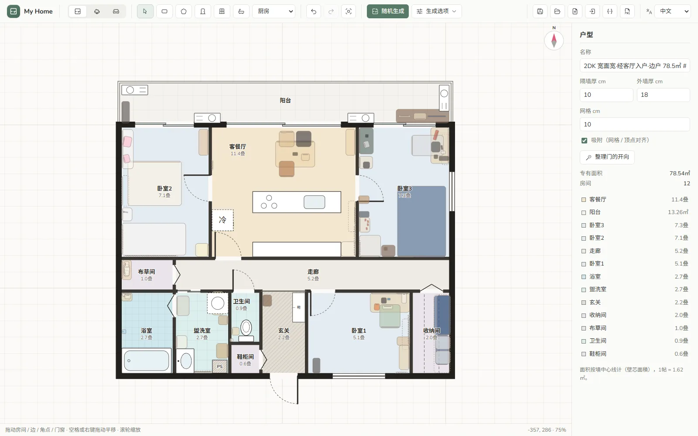
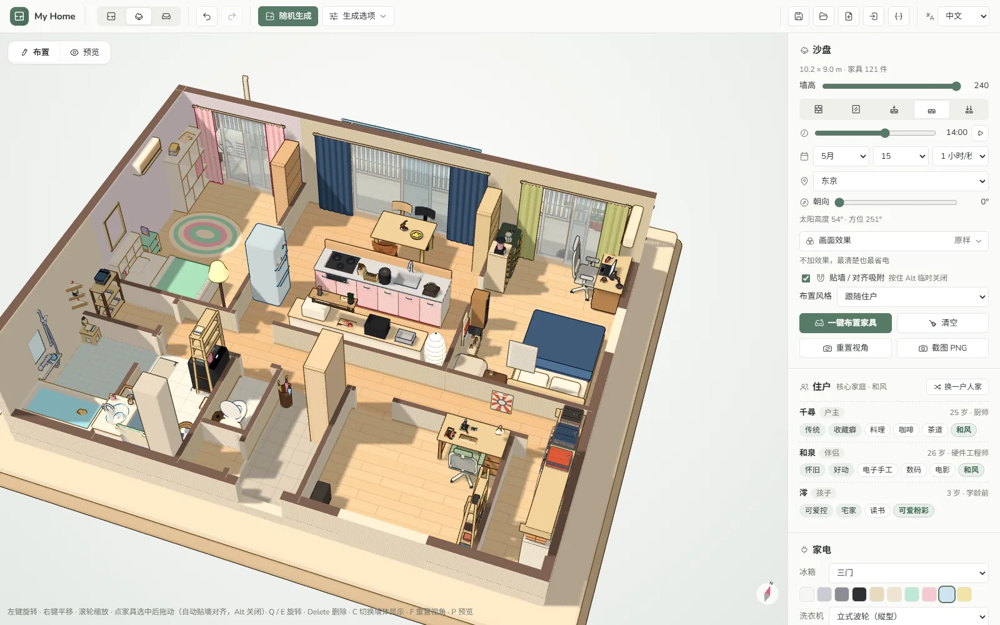
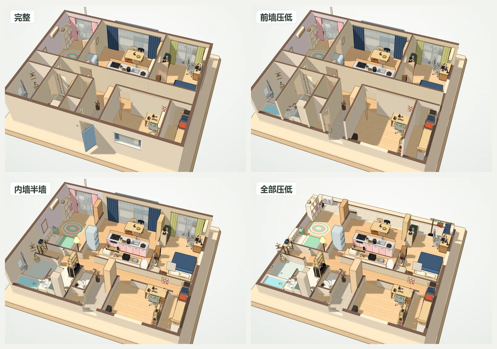
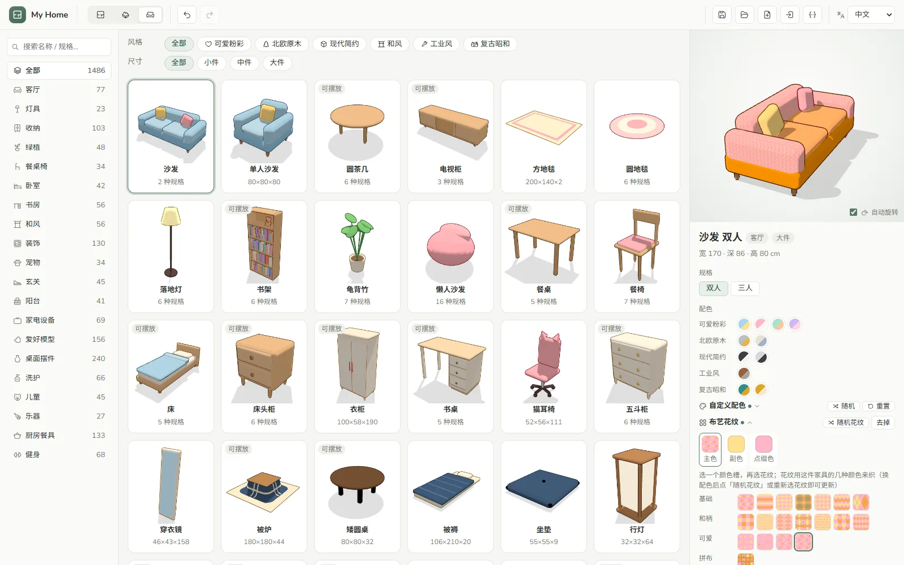
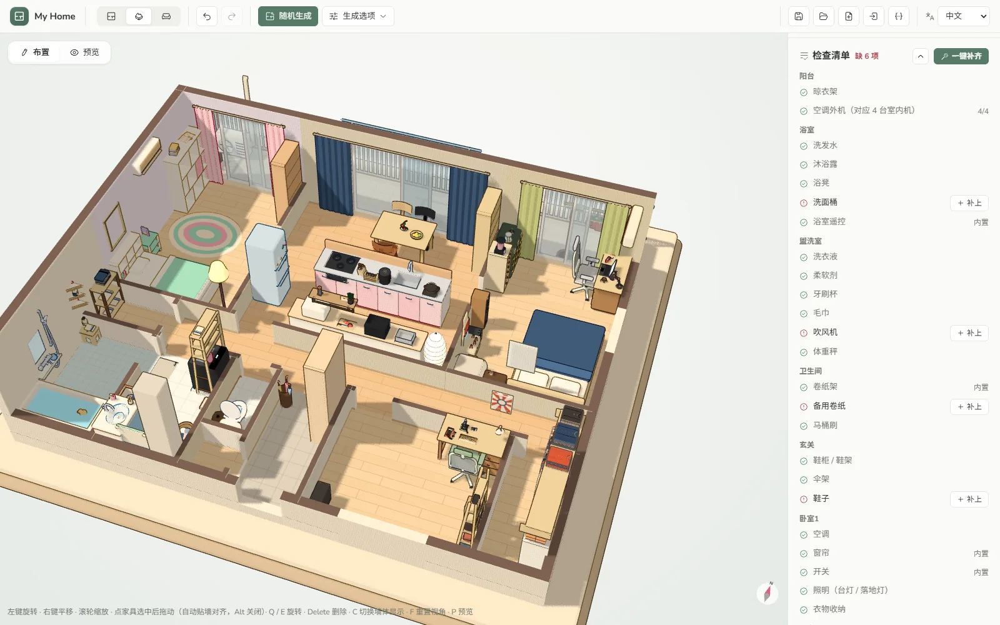
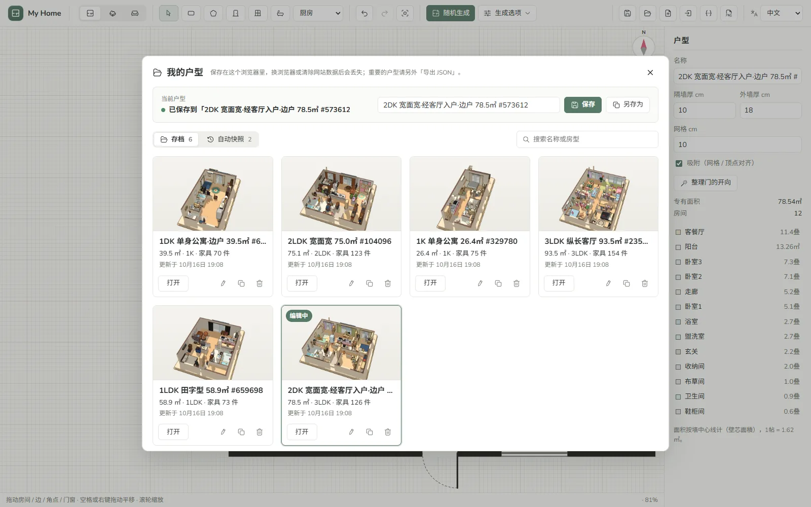

<div align="center">


# My Home

**在浏览器里生成一个日本的家，再把生活摆进去。**

随机生成 1K～3LDK 日式户型，按住户人设一键布置 2400+ 卡通素材，然后在 3D 沙盘里慢慢看。<br>
纯前端，免费，无需注册，数据只留在你的浏览器里。

[](https://vuejs.org/)
[](https://threejs.org/)
[](https://www.typescriptlang.org/)
[](https://vite.dev/)
[](public/manifest.webmanifest)

[](LICENSE)

[**在线体验**](https://my-home.example) · **中文** · [日本語](README.ja.md) · [English](README.en.md)

</div>

<br>

<p align="center">
  
</p>

## 功能

<table>
  <tr>
    <td width="50%" valign="top">
      
      <h3>户型生成与平面图</h3>
      随机生成 1K / 1DK / 1LDK / 2LDK / 3LDK：ユニットバス、洗衣机位、玄关、和室（自动铺榻榻米）、阳台、嵌墙鞋柜、WIC 一应俱全。可指定骨架（田字型、纵长客厅、宽面宽）、边户、面积和种子；也能用矩形 / 多边形工具自己画，再放门窗和设备，门的开向会自动整理。
    </td>
    <td width="50%" valign="top">
      
      <h3>一键布置与住户人设</h3>
      先按户型推断一户人家——家庭构成、年龄、职业、性格、兴趣——再按人设摆家具和生活小物：杆上挂的衣服、冰箱贴、晾衣架上的袜子、体重秤……空房间会变成书房、电竞房或音乐室；同类物件有数量上限，常见物件随机换款，不会千篇一律。
    </td>
  </tr>
  <tr>
    <td width="50%" valign="top">
      
      <h3>模拟人生式的墙</h3>
      五种墙体显示：完整、前墙透明、前墙压低、内墙半墙、全部压低，按 <kbd>C</kbd> 切换；可以让墙只在鼠标所指的房间前让开。toon 描边的卡通渲染，画面不动时不重绘，笔记本上也省电。
    </td>
    <td width="50%" valign="top">
      
      <h3>素材库、配色与花纹</h3>
      2400+ 个程序化生成的素材，分可爱粉彩、北欧原木、现代简约、和风、工业风、复古昭和 6 种风格。每件都能改配色、给布艺织花纹（波点、格子、和柄、拼布…），部分素材有多种形态：挂起、叠放、打开。
    </td>
  </tr>
  <tr>
    <td width="50%" valign="top">
      
      <h3>检查清单</h3>
      按房间列出过日子该有的东西：浴室有没有洗面桶、卫生间有没有备用卷纸、玄关有没有鞋。缺的可以逐项「补上」，也可以一键补齐。
    </td>
    <td width="50%" valign="top">
      
      <h3>我的户型</h3>
      户型存进浏览器本地（IndexedDB），带 3D 缩略图，可以搜索、重命名、复制；编辑时自动拍快照，改坏了能恢复。也可以导出 / 导入 JSON，导出平面图或 3D 截图 PNG。
    </td>
  </tr>
</table>

### 会动的家

<p align="center">
  
</p>

切到预览模式，猫狗会在家里散步、睡觉，扫地机器人出门清扫再回座充电，Kachaka 驮着架子在房间之间送东西。它们会绕开家具和墙找路。

### 还有

- **墙纸与边饰**：每个房间单独换墙纸（纯色 / 花纹）和腰线边饰，或按住户风格全屋随机。
- **衣物与衣架**：参数化生成的衣服、毛巾，挂在衣杆、晾衣架上，衣架和衣服分开建模。
- **三语界面**：简体中文 / 日本語 / English，按浏览器语言自动选择，也可用 `/ja/`、`/en/` 路径或 `?lang=ja` 指定。
- **PWA 与 SEO**：可安装到桌面；四个入口页各自带好对应语言的 title、Open Graph 和 JSON-LD。

### 正在做

- 中式、欧美户型生成
- 连续的时间光照：按时刻、日期、经纬度和户型朝向算太阳方位
- 后处理画面效果：移轴微缩、胶片、水彩、漫画网点、像素风……

## 快速开始

需要 Node.js 20+ 和 [pnpm](https://pnpm.io/)。

```bash
pnpm install
pnpm dev      # 开发服务器
pnpm test     # 单元测试（Vitest）
pnpm build    # 类型检查 + 构建静态站点到 dist/
```

## 部署

`dist/` 是纯静态文件，放到任意静态托管即可。canonical、`og:url`、hreflang、`sitemap.xml`、`robots.txt` 里的绝对地址来自环境变量 `VITE_SITE_URL`，上线前在项目根目录新建 `.env.production`：

```bash
VITE_SITE_URL=https://你的域名
```

或在构建时传入：`VITE_SITE_URL=https://你的域名 pnpm build`。构建会输出 `/`（运行时按浏览器语言切换）和 `/zh/`、`/ja/`、`/en/` 四个入口页，三语 SEO 文案在 `src/seo.ts`。

## 项目结构

```text
src/
├─ App.vue, components/   界面：平面图画布、3D 沙盘、素材库、配色编辑器、我的户型
├─ generate*.ts           户型生成（日式；中式 / 欧美按地区分派）
├─ household.ts           住户人设：家庭构成、职业、性格、兴趣
├─ decorate.ts            一键布置
├─ checklist.ts           检查清单
├─ store.ts, saved.ts     编辑状态与撤销；IndexedDB 存档与自动快照
├─ walls.ts, doors.ts, tatami.ts, place.ts, snap.ts, nav.ts
│                         墙体分析、开门方向、榻榻米铺法、设备摆放、吸附、宠物寻路
├─ i18n/                  中 / 日 / 英文案
└─ three/                 3D：toon 渲染、户型建模、素材与素材包、花纹、衣物、宠物与机器人、天空、后处理
test/                     Vitest 单元测试
scripts/                  素材尺寸表生成（pnpm gen:dims）
```

## 制作素材

素材全部用代码建模，没有外部模型文件。写新素材前先读 [`src/three/kit.ts`](src/three/kit.ts) 文件头的约定：单位厘米、贴墙一侧朝 −z、描边统一添加、表面贴片至少浮出 0.3cm、可摆放的家具声明 `surface` 而不把东西做死在模型里……素材包放在 `src/three/packs/`。

## 数据与隐私

没有服务器，也没有账号。当前户型和界面设置存在 `localStorage`，「我的户型」存档和自动快照存在 IndexedDB，都只在你自己的浏览器里。清除站点数据会一并清掉，重要的户型请「导出 JSON」备份。

## 致谢

- [three.js](https://threejs.org/)：3D 渲染
- [Vue](https://vuejs.org/) 与 [Vite](https://vite.dev/)
- [jannchie-icons](https://www.npmjs.com/package/@jannchie/icons)（`@jannchie/icons`、`@jannchie/icons-vue`）：界面图标

## 作者

[Jianqi Pan (Jannchie)](https://github.com/Jannchie)

## 许可证

[MIT](LICENSE) © 2026 Jianqi Pan
